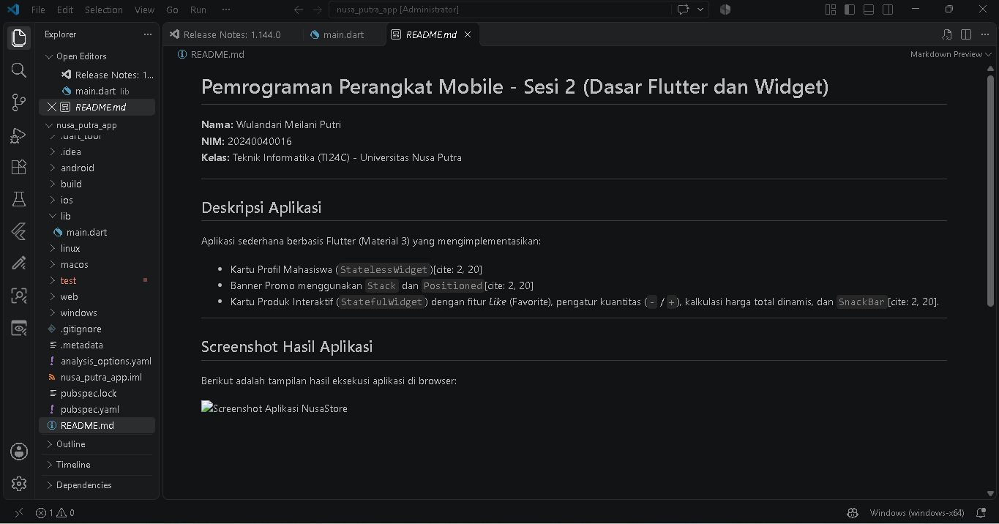

# Pemrograman Perangkat Mobile - Sesi 2 (Dasar Flutter dan Widget)

**Nama:** Wulandari Meilani Putri  
**NIM:** 20240040016  
**Kelas:** Teknik Informatika (TI24C) - Universitas Nusa Putra  

---

## Deskripsi Aplikasi
Aplikasi sederhana berbasis Flutter (Material 3) yang mengimplementasikan:
* Kartu Profil Mahasiswa (`StatelessWidget`)[cite: 2, 20]
* Banner Promo menggunakan `Stack` dan `Positioned`[cite: 2, 20]
* Kartu Produk Interaktif (`StatefulWidget`) dengan fitur *Like* (Favorite), pengatur kuantitas (`-` / `+`), kalkulasi harga total dinamis, dan `SnackBar`[cite: 2, 20].

---

## Screenshot Hasil Aplikasi
Berikut adalah tampilan hasil eksekusi aplikasi di browser:

